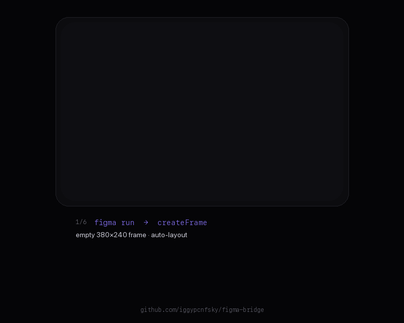

# Figma Bridge



A local bridge between an AI agent and Figma. The agent sends named operations; a Figma plugin
executes them through the Figma Plugin API and returns the results. No dependencies, no OAuth,
no cloud.

On top of that, the same plugin window is an **image panel** backed by
[`img-forge`](https://github.com/iggypcnfsky/img-forge) (a sibling checkout): generate or edit images
with fal.ai models and drop them straight onto the canvas.

The window also answers **who is on the canvas**: every agent that sends operations registers an
identity, the panel shows it (Agents tab, plus a live counter in the status bar), and you can name it
or mint one for a new agent.

**For agents:** [`AGENTS.md`](AGENTS.md) is written to be loaded as context.
**Drop-in prompt for another agent:** [`docs/handoff-prompt.md`](docs/handoff-prompt.md).
**Skills:** [`.agents/skills/figma-bridge/SKILL.md`](.agents/skills/figma-bridge/SKILL.md) and the
sibling `img-forge` skill.

## Why not the official Figma MCP

| | Figma Bridge | official remote MCP | official desktop MCP |
|---|---|---|---|
| Writes to the canvas | yes | yes | **no** |
| OAuth / tokens | none | yes | none |
| Client allowlist | not applicable | yes | no |
| Requirements | Node ≥ 20 + Figma desktop | paid plan | Dev/Full seat on a paid plan |
| Context cost in the agent | 1 tool (`run`) | ~30 tool definitions | ~10 |
| Coupled to Figma's decisions | no | high | medium |

What it cannot do by itself: create files in the cloud, capture live UI, FigJam diagrams, shaders,
Weave — those are server-side Figma features, not part of the Plugin API. Image generation is not a
Figma feature at all; that is what the `img-forge` pairing adds.

## How it works

```
agent ──HTTP──▶ server.mjs (localhost:3847) ◀──long-poll── plugin/ui.html
                        │                                        │
                        ├── {ops:[…]} ────────────────────────────┴─▶ plugin/code.js ─▶ figma.*
                        └── image jobs ──▶ img-forge CLI ──▶ fal.ai
```

- `server.mjs` — job queue plus long-poll, no WebSockets, no npm packages.
- `bin/figma` — CLI: `status`, `agents`, `ping`, `selection`, `pages`, `variables`, `op`, `run`,
  `export`, `image`.
- `plugin/code.js` — around 30 operations: frames, text (`text` restyles existing type, whole node or
  a character range), shapes, instances, `update`, `clone`,
  `reparent`, `group`, `align`, `distribute`, `placeNear`, `measure`, layout grids (`setGrids`),
  effects and blur, gradients, `constraints`, `sizing`, instances, styles, `export`, `imageFill`,
  `variables`, `varFill`, `fonts`, `exec`.
- `plugin/ui.html` — the status bar and the image panel.

Several Figma windows may run the plugin at once. Each reports an id, file and page, and the server
routes by them: a single window is used automatically, ambiguity returns `409` with the list instead of
answering from the wrong file (`./bin/figma clients`, `--file`, `--client`).

Several agents may also share one canvas. A window executes one batch at a time: the server marks it
busy and hands it the next job only when the previous result is back, and the plugin queues batches as
a second line of defence. Different windows are independent lanes. What the bridge cannot do is guess
intent — reads still go stale between batches, and two agents writing the same node end with the last
write winning, so partition by frame and keep batches short.

Each agent has an identity: `--agent`, `FIGMA_AGENT`, or (under DSH) the session id automatically,
plus an optional human label (`--label` / `FIGMA_AGENT_LABEL`) that the panel shows instead of the id.
`figma agents` lists them; the panel's **Agents** tab shows the same list with a live counter in the
status bar, lets you rename one, forget it, or mint a fresh id with the command to start it.

## Install

Requires Node ≥ 20 and the Figma desktop app.

```bash
# 1. server
cd figma-bridge
node server.mjs            # leave it running (port 3847)

# 2. plugin in Figma
#    Plugins → Development → Import plugin from manifest… → plugin/manifest.json
#    Plugins → Development → Figma Bridge   (in the file you want the agent to work on)

# 3. verify
./bin/figma status         # pluginConnected: true
./bin/figma selection
```

The plugin window must stay open — it *is* the connection. Closing it disconnects the bridge.
After editing plugin files, re-run the plugin; manifest changes require a re-import.

## Usage

`figma` is on `PATH` (a symlink to `bin/figma`), so these work from any directory:

```bash
figma doctor                               # repo, server, windows, img-forge in one call
figma rules                                # project constraints: type floor, grid, version naming
figma clients                              # which Figma windows are connected
./bin/figma --file ITHAKA selection 2      # target one file when several are open
./bin/figma selection 2
./bin/figma op '{"op":"createFrame","name":"Card","width":320,"height":200,"fill":"#0B0B0F","props":{"cornerRadius":16,"layoutMode":"VERTICAL","paddingTop":24,"itemSpacing":12}}'
./bin/figma run '[
  {"op":"createText","parentId":"12:34","characters":"Title","fontSize":24,"color":"#FFFFFF"},
  {"op":"createFrame","parentId":"12:34","name":"CTA","width":108,"height":36,"fill":"#6E56CF","props":{"cornerRadius":18,"layoutMode":"HORIZONTAL","primaryAxisAlignItems":"CENTER","counterAxisAlignItems":"CENTER"}}
]'
./bin/figma export 12:34 out/card.png PNG 2
./bin/figma image 12:34 out/cover.png FILL     # local image file → fill, no cloud upload
```

Full parameter reference: [`docs/ops-reference.md`](docs/ops-reference.md).

Every frame of the demo GIF above is a real export from Figma after one operation —
reproduce it with `scripts/demo-build.sh` and `scripts/make-demo-gif.py`.

## Image generation

The plugin window doubles as an image panel. It never sees the API key: it posts a job to the local
server, which runs the sibling `img-forge` CLI. That keeps one engine for the panel and for the agent,
and a 40-second generation never blocks Figma.

**Prerequisites**

- [`img-forge`](https://github.com/iggypcnfsky/img-forge) checked out next to this repo (override with
  `IMG_FORGE_BIN`),
- `FAL_KEY` in `img-forge/.env` (or `~/.config/img-forge/key`),
- that is it — no extra npm packages, no SDK.

Without a key the panel still loads, and a job fails with a readable message in the log.

### The panel

Click `⌃` in the status bar. The window expands to `360×668` with two tabs.

| Control | What it does |
|---|---|
| **Model** | populated from `GET /image/models` (a small registry in `img-forge/models.json`) |
| **reasoning / quality** | populated from that model's **OpenAPI schema**, so the dropdowns can only offer values the endpoint accepts; a model without the field hides it |
| **Use selection / Add selection / Add image…** | references for Edit: *Use selection* makes the selected frame the base (exported at 2×, sets the output size), *Add selection* appends another canvas selection as `#image2`, `#image3`…, *Add image…* takes files from disk; 100 px thumbnails with the file name underneath, ✕ to drop one |
| **Paint mask…** | constrain the edit to an area: paint over the reference with the brush (erase with `E`), name the mask, `+` starts another in a new colour |
| **Corner grips** | any of the four corners drags the window (double-click resets); the preview and the mask canvas grow with it, and the size is remembered |
| **Prompt** | text; for Edit this describes the change |
| **Size (W × H)** | the only size control: type it (64–8192 px) or derive it from a selection — *Use selection* fills both fields, so an edit matches its frame instead of being re-cropped |
| **≈ $0.0123 · 1024×1024 · high** | token-based estimate before you spend anything |
| **Generate / Edit image** | posts the job, polls it, streams the log |
| **Insert on canvas** | a plain rectangle with an image fill at the viewport centre — a picture on the canvas, not a frame child. Every finished job is inserted automatically (no checkbox); *Insert on canvas* re-inserts the previewed one |
| **Fill selection** | replaces the fill of the selected node |
| **Copy** | puts the whole log on the clipboard — for reporting a failure |

**Edit** takes references — the current selection (`exportAsync`, 2×) or any number of image files
picked from disk; each thumbnails under the row and can be removed with ✕. The server writes them into
the job directory and passes one `--ref` per image to `img edit`, which uploads them to the fal CDN.
The first reference's dimensions become the active size, so an edit keeps its proportions instead of
being re-cropped to a fixed aspect. From the CLI it is the same thing without the panel:
`img edit --prompt "…" --ref a.png --ref b.png` (also `--ref-url`, `--mask`, `--markup`).

A **mask** narrows the edit to part of the image. fal's rule is blunt: **white = change, black =
keep**, and the mask must be the size of the image. The panel paints it for you — *Paint mask…* opens
the first reference with a brush (erase with `E`, *Clear*, *Use mask*). A picker in the editor switches
between masks, **+ new** starts another one in the next colour, and the other masks stay visible while
you paint. Switching, closing the panel or leaving the Edit tab **autosaves** the mask you were
painting (an empty one is never created), and `+` next to *Paint mask…* starts another mask with the
same autosave — so `+`, paint, `+`, paint is the whole loop. Shortcuts while painting: `N` new mask,
`[` / `]` previous/next, `E` erase, `⌘S` save and close — dimmed, each in its own colour, so an adjacent region is easy to hit. The strokes are
stored at the image's own resolution (1920×1080 reference ⇒ 1920×1080 mask, no upscaling at save) while the preview
is only a window rendered at device pixels, so enlarging the panel makes it sharper instead of
blockier. The panel's brush is the way in — masks are painted there, at the reference's pixel size.

**Several masks, one call.** Each mask in the list has its own name and colour, but fal accepts
exactly one mask per request, so the panel combines them: the masks are
OR-ed into a single white `mask_url` (the edit stays inside the marked regions) and a colour map of the
reference — each area tinted with its mask's colour — is attached as the **last reference**, with a
legend in the prompt:

> "wall" marked in #ff00ff — swap for the material in reference image 2 (wall.png); "window" marked
> in #00b3ff. Change only the marked areas, keep everything else untouched.

The model sees the colours, the mask constrains the edit, and you pay once — the cost line says
`≈ $0.0281 · 3 masks combined`. It is less exact than one mask on its own (the model has to respect
the legend), which is why a single mask is still sent as a plain mask without the colour map.

**Runs are jobs you can queue.** Press *Generate* / *Edit image* and the panel returns immediately; the
run appears in the **Jobs** tab with its status and cost, and you can start the next one while it
works. Clicking a job shows its result and restores **that run's** prompt, references, masks, size and
model — a snapshot taken before submitting, so tuning a variation never silently uses whatever is on
the easel now. History keeps the last 15 runs (each holds images in memory). The server runs up to three `img-forge`
processes at once (`IMAGE_CONCURRENCY`, 1–8); the rest wait in its queue. Auto-insert applies to each
finished job, so turn it off if you are queueing several.

**Generate and Edit are different jobs.** *Generate* calls the text-to-image endpoint: it makes a new
picture from the prompt and **ignores references** (an edit is not what it does). *Edit* uses the
references, the masks and the sizes. If references are attached while Generate is selected, the panel
says so under the tabs and offers a one-click switch to Edit — and the job log repeats it, because a
silently ignored reference looks exactly like a broken edit.

**Sizes have to agree**, because fal compares the mask with the first image and rejects a mismatch. The
panel therefore derives every reference's pixel size from the exported PNG itself (not from the node's
CSS size), and a selection wider than 1600 px is exported at 1× so a 1920-wide frame stays 1920 px
instead of silently becoming 3840. If a mask ever disagrees with the base, the panel says so before
the call and the server refuses the job (`400 … identical dimensions`) instead of spending on a 422.

**How the prompt is assembled** — one place, so it is predictable:

| masks | what actually goes to fal |
|---|---|
| none | the prompt alone |
| one | the prompt, then `Change only the masked area: <that mask's instruction>. Keep everything outside it untouched.` |
| two or more | the prompt, then the colour-map legend naming every mask, its colour and its instruction |

An empty mask instruction means the mask adds no sentence — the prompt still describes the change. The
composed prompt is echoed into the panel log (`prompt · …`), so you can see the exact text before
spending anything.

**References are numbered.** The first thumbnail is `#image1`, the second `#image2`, and the numbers
are drawn on the thumbnails with the file name right under each one — so you can tell which file is
which before writing a prompt. Write `#image2` in any instruction and the panel expands it to
`reference image 2 (filename.png)` before sending — the model reads that, the API only sees order.

### Cost and limits

Estimates come from token pricing in `img-forge/models.json` (`$30/1M` output image tokens, `$8/1M`
cached, `$5/1M` text input) — the same numbers fal publishes — plus `baseImageTokens` per quality
level and a linear area scale from 1024×1024. They are estimates, not invoices.

Every job passes `--max-usd` (default `$0.5`, override with `IMAGE_MAX_USD`) and `img-forge` refuses
**before any network call** when the estimate is above it:

```
1:1 @1024  low   $0.0082
1:1 @1024  high  $0.1249
16:9 @2k   high  $0.2809
16:9 @2k   max   $0.8425   → refused
```

### HTTP API

All image endpoints reject requests carrying a foreign `Origin` (403), so a web page you visit
cannot spend credits. There is no token: the key sits on disk anyway.

| Endpoint | Purpose |
|---|---|
| `GET /image/models` | registry with labels, size modes and pricing |
| `GET /image/schema?model=…` | that endpoint's input schema, flattened |
| `GET /image/presets` | saved `{label,width,height}` presets |
| `POST /image/presets` | add one (64–8192 px, deduplicated) |
| `POST /image/jobs` | `{mode, model, prompt, size, quality, refs?, dryRun?}` → `{id}` |
| `GET /image/jobs/:id` | `{status, log, result:{file, base64, width, height, cost}}` |

Jobs run one at a time and expire after 30 minutes.

### Not in the panel (use the CLI)

`--mask` / `--markup` for inpainting, `num_images > 1`, raw `--set` for model-specific knobs,
`--dry-run` payload inspection, and the spend log (`img-forge spend`). The panel is a convenience
layer; the CLI is the full surface.

## Agent skill

The repo ships a ready skill in `.agents/skills/figma-bridge/SKILL.md`. Install it globally so
every agent session can pick it up:

```bash
cp -R .agents/skills/figma-bridge ~/.agents/skills/
```

The pairing skill for image generation lives in `img-forge/.agents/skills/img-forge/`. DSH discovers
skills from `<repo>/.agents/skills` (project), `~/.dsh/skills` and `~/.agents/skills` (global) and
watches those directories, so a new skill appears without a restart. Verify with
`skill figma-bridge`.

## Testing without Figma

```bash
node server.mjs &
node scripts/mock-plugin.mjs &      # simulates the plugin
./bin/figma ping                    # → mock-plugin/1
```

Image jobs can be exercised without spending a cent: `POST /image/jobs` with `"dryRun": true` returns
the payload the CLI would send, including the cost estimate.

## Security

- The server binds only to `127.0.0.1` and `::1` — no LAN exposure.
- The plugin talks to exactly one origin, `http://localhost:3847`, declared in the manifest's
  `networkAccess`; the panel needs no fal.ai domain because only the server talks to fal.
- No tokens or OAuth in Figma: the API key never leaves the machine and never enters plugin code.
- CORS is **not** `*`: only the plugin iframe (`Origin: null`) and local tools without an Origin get
  an allow header, and `/image/*` additionally answers 403 to any foreign `Origin`.
- Image spending is capped per job (`--max-usd`) and every result is recorded in a manifest.
- `exec` runs arbitrary JS inside the plugin sandbox. That is deliberate — it is what makes the
  bridge a full Plugin API — but an agent that is careless can do more to a file than intended.
  Figma's own undo (⌘Z) is the safety net.

## License

MIT — see [`LICENSE`](LICENSE).
